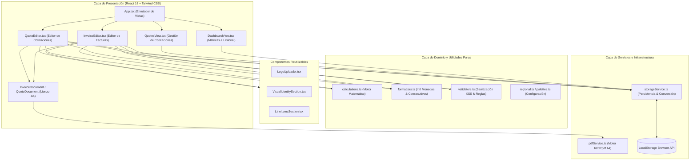
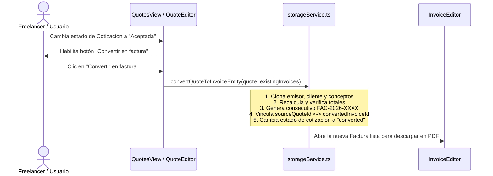

<div align="center">

# Generador de Facturas y Cotizaciones Online

**Plataforma SaaS internacional para la creación, personalización en tiempo real y exportación en PDF (Formato A4) de cotizaciones comerciales y facturas profesionales.**

[](https://generador-facturas-online.josramirez972.workers.dev)
[](https://react.dev/)
[](https://www.typescriptlang.org/)
[](https://tailwindcss.com/)
[](https://vitejs.dev/)

<br />

[🌐 **Explorar Demo en Vivo**](https://generador-facturas-online.josramirez972.workers.dev) · [📂 **Explorar Código Fuente**](./src) · [🚀 **Guía de Instalación**](#-instalación-y-despliegue)

</div>

---

## 📋 Descripción General

**Generador de Facturas y Cotizaciones Online** es una aplicación web diseñada bajo una estética minimalista tipo SaaS (inspirada en *Stripe*, *Linear* y *Vercel*), enfocada en **freelancers, desarrolladores, diseñadores, consultores y pequeños negocios** de Latinoamérica, Estados Unidos y Europa.

El sistema resuelve el flujo comercial completo de un profesional independiente:
1. **Cotizar un proyecto** definiendo alcance técnico, tiempos de ejecución y condiciones de pago.
2. **Gestionar el estado** de la propuesta comercial (`Borrador`, `Enviada`, `Aceptada`, `Rechazada`, `Vencida`).
3. **Convertir la cotización aprobada en factura con un solo clic**, reutilizando automáticamente emisor, cliente, conceptos, descuentos e impuestos sin reescribir datos y manteniendo trazabilidad bidireccional entre ambos documentos.
4. **Exportar un documento PDF en formato A4** idéntico a la vista previa en tiempo real.

---

## ✨ Características Principales

| Módulo | Funcionalidades Clave |
| :--- | :--- |
| **🌍 Internacionalización y Configuración Regional** | • **Identificación tributaria dinámica y opcional**: Adapta sugerencias según el país (`NIT`, `RFC`, `RUT`, `RUC`, `CUIT`, `NIF / CIF`, `EIN / Tax ID`).<br>• **Soporte Multimoneda sin conversión forzada**: `COP`, `USD`, `EUR`, `MXN`, `PEN`, `CLP` y `ARS` con formato nativo `Intl.NumberFormat`.<br>• **Impuestos flexibles**: Permite facturar sin impuestos (`0%`) o configurar nombre (`IVA`, `IGV`, `ITBMS`, `Sales Tax`) y tasa porcentual libremente. |
| **📑 Módulo de Cotizaciones / Presupuestos** | • Consecutivo automático `COT-2026-0001` y selector de título (`COTIZACIÓN` o `PRESUPUESTO`).<br>• Campos específicos de propuesta: **Alcance del proyecto**, **Tiempo estimado de ejecución**, **Condiciones de pago** y **Fecha de validez**.<br>• **Conversión en 1 clic a Factura** cuando el estado es `Aceptada`, con bloqueo anti-duplicados. |
| **🧾 Módulo de Facturación Comercial** | • Consecutivo automático `FAC-2026-0001`, fechas de emisión/vencimiento y métodos de pago.<br>• Gestión de estados (`Borrador`, `Generada`, `Enviada`, `Pagada`, `Vencida`).<br>• Directorio de **clientes frecuentes** con autocompletado instantáneo, creación y eliminación. |
| **🎨 Identidad Visual y Motor PDF A4** | • **3 Paletas corporativas sugeridas** (*Minimalista*, *Profesional Azul*, *Elegante Verde*) + selector de color hexadecimal en vivo.<br>• **Gestor de logotipo con validación de seguridad**: Validación de tipo MIME (`PNG`, `JPG`, `SVG`, `WebP`) y peso máximo (`2 MB`).<br>• **Exportación PDF de alta precisión**: Renderizado A4 (`794px × 1122px`) con protección de cortes de fila (`.avoid-page-break`). |

---

## 🏗️ Arquitectura del Sistema y Flujo de Datos

El proyecto fue construido desde cero aplicando **Separación de Responsabilidades (Separation of Concerns)** en 5 capas desacopladas, permitiendo que la lógica de negocio y la persistencia sean independientes de la interfaz gráfica.



### Estructura de Directorios

```text
├── index.html                          # Punto de entrada HTML con tipografías Inter y JetBrains Mono
├── package.json                        # Dependencias y scripts de construcción/despliegue
├── wrangler.jsonc                      # Configuración de despliegue en Cloudflare Workers / Pages
├── tailwind.config.js                  # Configuración de diseño y tokens de color neutros
├── tsconfig.json                       # Configuración estricta de TypeScript
├── vite.config.ts                      # Configuración del bundler Vite + plugin Cloudflare
└── src/
    ├── main.tsx                        # Montaje del árbol de React
    ├── App.tsx                         # Estado global, navegación y flujo de conversión Cotización -> Factura
    ├── index.css                       # Directivas Tailwind y reglas CSS de impresión/paginación PDF
    ├── types/
    │   ├── invoice.ts                  # Contratos TypeScript (Invoice, Quote, EmitterProfile, ClientData)
    │   └── html2pdf.d.ts               # Definiciones de tipos para html2pdf.js
    ├── config/
    │   ├── regional.ts                 # Diccionario internacional de países, etiquetas fiscales y divisas
    │   └── palettes.ts                 # Configuración de las 3 paletas corporativas sugeridas
    ├── utils/
    │   ├── calculations.ts             # Funciones puras de cálculo financiero por ítem y documento
    │   ├── formatters.ts               # Formateadores de moneda (Intl.NumberFormat), fechas y consecutivos
    │   └── validators.ts               # Validación de entradas, correos, rangos numéricos y seguridad MIME
    ├── services/
    │   ├── storageService.ts           # Capa de persistencia desacoplada y clonación profunda Quote -> Invoice
    │   └── pdfService.ts               # Configuración de html2canvas + jsPDF en formato A4 retrato
    └── components/
        ├── dashboard/
        │   ├── DashboardView.tsx       # Panel principal con KPIs, facturas y cotizaciones recientes
        │   └── ProfileSettingsModal.tsx# Modal de configuración persistente del perfil del emisor
        ├── quotes/
        │   └── QuotesView.tsx          # Panel especializado de cotizaciones con conversión en 1 clic
        ├── editor/
        │   ├── InvoiceEditor.tsx       # Formulario interactivo de facturas + vista previa sticky
        │   ├── QuoteEditor.tsx         # Formulario interactivo de cotizaciones + alcance del proyecto
        │   ├── LineItemsSection.tsx    # Editor dinámico de líneas de servicio e impuestos configurables
        │   ├── LogoUploader.tsx        # Cargador de logotipo Base64 con validación de seguridad
        │   └── VisualIdentitySection.tsx# Tarjetas de paletas y selector hexadecimal en tiempo real
        └── preview/
            ├── InvoiceDocument.tsx     # Hoja A4 de Factura Comercial (forwardRef)
            └── QuoteDocument.tsx       # Hoja A4 de Cotización / Presupuesto Comercial (forwardRef)
```

---

## 🧮 Motor de Cálculo Económico y Fórmulas

El módulo [`src/utils/calculations.ts`](./src/utils/calculations.ts) implementa funciones puras deterministas que se ejecutan en cada pulsación del usuario para actualizar instantáneamente tanto el formulario como la hoja A4.

Para cada concepto o línea $i \in \{1, \dots, n\}$ con cantidad $q_i \ge 0$, precio unitario $p_i \ge 0$, porcentaje de descuento $d_i \in [0, 100]$ y porcentaje de impuesto $t_i \in [0, 100]$:

1. **Importe Bruto por Línea ($\text{Bruto}_i$):**
   $$\text{Bruto}_i = q_i \times p_i$$

2. **Descuento Monetario por Línea ($\text{Desc}_i$):**
   $$\text{Desc}_i = \text{Bruto}_i \times \left(\frac{d_i}{100}\right)$$

3. **Base Imponible / Neto antes de Impuestos ($\text{Neto}_i$):**
   $$\text{Neto}_i = \text{Bruto}_i - \text{Desc}_i$$

4. **Impuesto por Línea ($\text{Imp}_i$):**
   $$\text{Imp}_i = \begin{cases} \text{Neto}_i \times \left(\frac{t_i}{100}\right) & \text{si los impuestos están activados} \\ 0 & \text{si la factura/cotización es sin impuestos} \end{cases}$$

5. **Totales Globales del Documento:**
   $$\text{Subtotal} = \sum_{i=1}^{n} \text{Bruto}_i \quad \Big| \quad \text{Total Descuentos} = \sum_{i=1}^{n} \text{Desc}_i \quad \Big| \quad \text{Total Impuestos} = \sum_{i=1}^{n} \text{Imp}_i$$

   $$\mathbf{\text{Total a Pagar / Cotizado}} = \sum_{i=1}^{n} \left(\text{Neto}_i + \text{Imp}_i\right)$$

---

## 🔄 Flujo de Conversión: Cotización a Factura (Trazabilidad)

Uno de los pilares de ingeniería del proyecto es mantener **Facturas (`Invoice`)** y **Cotizaciones (`Quote`)** como entidades separadas pero vinculadas mediante referencias cruzadas:



---

## 🔗 Enlaces del Proyecto y Vistas Clave

- 🌐 **Aplicación Desplegada en Producción (Cloudflare):**  
  👉 **[https://generador-facturas-online.josramirez972.workers.dev](https://generador-facturas-online.josramirez972.workers.dev)**
- 💻 **Repositorio Oficial en GitHub:**  
  👉 **[https://github.com/josramirez972-debug/generador-facturas-online](https://github.com/josramirez972-debug/generador-facturas-online)**

### Vistas integradas en la aplicación en vivo:
1. **Dashboard General**: Métricas de facturación, KPIs de cotizaciones (pendientes, aceptadas, convertidas y valor total cotizado) e historial unificado con acciones rápidas.
2. **Editor de Facturas (Split-View)**: Formulario paso a paso a la izquierda y lienzo A4 reactivo a la derecha (con modal a pantalla completa en dispositivos móviles).
3. **Editor y Gestor de Cotizaciones**: Incluye bloque de alcance del proyecto, tiempos de entrega, validez de la oferta y botón de conversión directa a factura.

---

## 🚀 Instalación y Despliegue

### Requisitos previos
- **Node.js** `>= 18.x`
- **npm** `>= 9.x`

### 1. Clonar e instalar dependencias
```bash
git clone https://github.com/josramirez972-debug/generador-facturas-online.git
cd generador-facturas-online
npm install
```

### 2. Ejecutar servidor de desarrollo local
```bash
npm run dev
```
Abre `http://localhost:5173/` en tu navegador.

### 3. Compilar y desplegar en Cloudflare
```bash
# Compilar bundle de producción (TypeScript + Vite)
npm run build

# Desplegar directamente en Cloudflare Workers / Pages
npm run deploy
```

---

## 🛡️ Seguridad y Escalabilidad

- **Validación de Archivos**: Restricción estricta en cliente para logotipos únicamente con tipos MIME `image/png`, `image/jpeg`, `image/svg+xml` e `image/webp` de hasta `2 MB`.
- **Sanitización de Entradas**: Prevención contra inyecciones de scripts y validación de formatos de correo electrónico y rangos numéricos positivos.
- **Preparado para SaaS en la Nube**: Gracias a que toda la persistencia está encapsulada en [`src/services/storageService.ts`](./src/services/storageService.ts), la migración futura desde `localStorage` hacia una base de datos relacional (**PostgreSQL / Supabase / Cloudflare D1**) no requiere modificar los componentes de React.

---

## ⚖️ Aviso sobre el Alcance Comercial

Los archivos PDF generados por esta aplicación corresponden a **facturas comerciales / cuentas de cobro** y **cotizaciones / presupuestos comerciales**. No sustituyen ni equivalen a comprobantes fiscales electrónicos timbrados ante autoridades tributarias locales (como DIAN, SAT, SII, SUNAT o AFIP).
